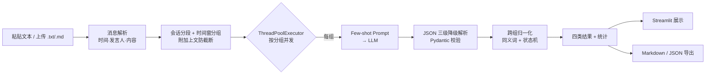

# ChatInsight · 群聊 / 会议纪要智能摘要

> 输入一段群聊或会议纪要文本，自动结构化输出**任务分配 / 进度 / 风险 / 待办**，支持 OpenAI 兼容 API 与本地 Ollama 模型，内置 Mock 模式（无需 API Key 即可完整演示）。
>
> **演示项目声明**：本项目为个人教学/演示项目，灵感来自真实企业场景的抽象；仓库内所有对话、人名、项目名均为虚构，与任何公司无关。

## 功能特性

- **结构化抽取**：Few-shot 提示词把非结构化的群聊/会议纪要解析为「任务分配 / 进度 / 风险 / 待办」四类结果，输出严格 JSON
- **上下文防截断**：按「会话 + 30 分钟时间窗」分组，每组附带上文末尾 5 条消息——否则"收到""已完成 80%"这类省略主语的回复无法归属任务
- **并发调用**：`ThreadPoolExecutor` 按分组并发调用 LLM（默认 5 线程，可配置），单组失败不阻塞其他组
- **任务归一化**：同一任务的多种表述（"原型图出一版"/"原型图整体框架"/"原型图初稿"）收敛为一条，状态机只进不退（todo → doing → done）
- **弹性解析**：LLM 输出三级降级（直接解析 → 代码块提取 → 修复重试 → 降级记录），绝不静默丢消息
- **Mock 模式**：内置确定性规则引擎，无 API Key 也能跑通全流程并支撑测试
- **可导出**：一键导出 Markdown 报告 / 原始 JSON

## 架构



## 快速开始

```bash
# 1. 安装依赖
pip install -r requirements.txt

# 2a. Mock 模式（无需任何 Key，直接演示）
streamlit run app.py

# 2b. 真实 LLM（任何 OpenAI 兼容端点）
cp .env.example .env   # 填入 OPENAI_API_KEY / OPENAI_BASE_URL / CHATINSIGHT_MODEL
# 本地 Ollama 示例：OPENAI_BASE_URL=http://localhost:11434/v1
streamlit run app.py
```

运行测试：

```bash
pytest -v
```

测试全程使用 Mock/脚本化假客户端，不发起真实网络调用。

## 目录结构

```
chatinsight/
├── app.py                  # Streamlit 入口（模式切换 + 四类结果 + 导出）
├── core/
│   ├── config.py           # 环境配置（dataclass）
│   ├── models.py           # Pydantic 数据模型（消息/条目/分组结果/统计）
│   ├── parser.py           # 对话文本 → 消息列表（容错无时间戳）
│   ├── grouper.py          # 会话 + 时间窗分组 + 上下文拼接
│   ├── prompt.py           # Few-shot 提示词模板（LangChain ChatPromptTemplate）
│   ├── mock_engine.py      # Mock 规则引擎（演示/测试专用）
│   ├── llm.py              # LLM 客户端协议 + Mock/LangChain 双实现
│   ├── analyzer.py         # 分组分析 + JSON 三级降级 + Pydantic 校验
│   ├── normalizer.py       # 任务归一化（同义词 + 状态机）
│   ├── exporter.py         # Markdown / JSON 导出
│   └── pipeline.py         # 10 步流程编排（并发在这里，可被测试验证）
├── tests/                  # pytest：解析/降级/归一化/并发/导出/黄金测试
├── data/samples/           # 虚构示例对话 + 预期输出（Mock 数据源）
└── docs/                   # 设计说明
```

## 设计取舍（面试常问）

| 问题 | 选择与理由 |
|---|---|
| 为什么用 Few-shot 而不是零样本？ | 企业群聊口语化、简称多、格式杂；示例锚定分类边界和输出 schema，显著提升抽取稳定性 |
| 为什么示例内联而不用 FewShotPromptTemplate？ | 示例固定且量小，示例选择器的检索能力用不上，只会增加间接性 |
| 为什么线程池而不是 asyncio？ | LLM 调用是 IO 密集型，线程池实现简单、并发上限可控（避免触发供应商限流） |
| 为什么手动解析 JSON 而不用 PydanticOutputParser？ | 手动解析才能实现"代码块提取 → 修复重试 → 降级记录"的弹性链，不会一次失败就抛异常 |
| 为什么每组要附带上文？ | 群聊大量消息省略主语，没有上文就无法判断"收到"属于哪个任务 |
| LLM 不给时间怎么办？ | 时间是编排层按 raw_text 匹配回填的——LLM 只负责语义，编排层负责事实 |
| 没有 API Key 怎么演示？ | Mock 模式内置规则引擎，输出与真实 LLM 同构的合法 JSON |

## 测试

| 文件 | 覆盖 |
|---|---|
| `test_parser.py` | 时间戳解析、无时间戳继承、非消息行忽略 |
| `test_analyzer.py` | 三级降级、重试后成功、持续失败降级、脏条目丢弃、时间回填 |
| `test_normalizer.py` | 同义词归一化、跨组合并、状态机不回退、风险不过键 |
| `test_concurrency.py` | 5 组并发快于串行、单组失败不阻塞其他组 |
| `test_exporter.py` | Markdown 四类区块、JSON 序列化、示例数据黄金测试、端到端流水线 |

## 免责声明

本项目为个人教学/演示项目，所有数据均为虚构，不含任何公司生产代码或真实业务数据；请勿将示例数据用于任何真实业务场景。
